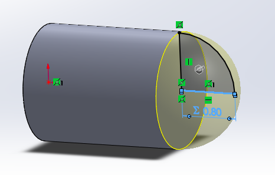
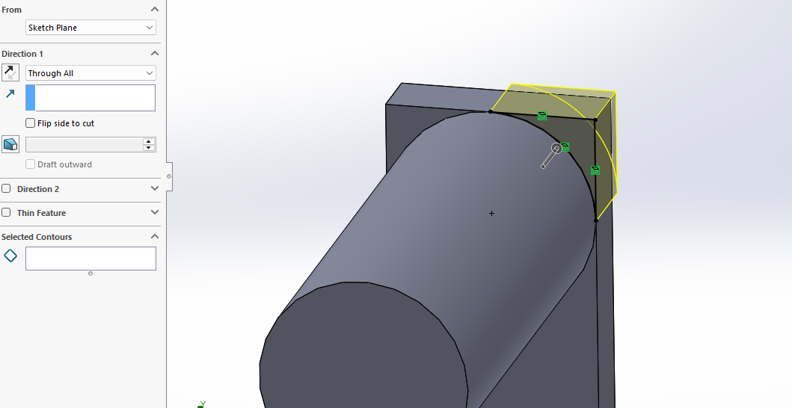
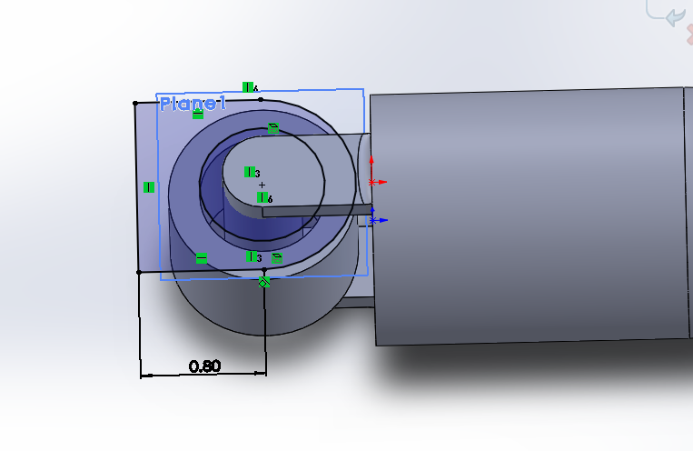
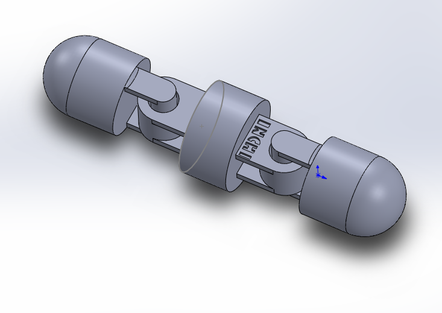

# A7 – [Topic]

## Objective
Design, 3D print, and document a working linkage or mechanism that performs a defined motion or task using only purchased hardware and 3D printed designed parts.

## Design

**Purpose**

For my design, I intend to make a fidget toy part limited to one degree of motion to each interlinked segment. I was inspired to create an print in part because of an interest in the design behind articulated fidgets, which are often printed in one piece.

**Components**
**Tolerances**
For each pin, I chose a the high end of a clearance I found on OZ FDM for print in place parts. At a 0.15 inch clearance for each hole, the moving parts will be very loose. This accommodates for any necessary size-down scaling in the pre-processing process.
**Key Design Decisions**

*Decision 1*
The first key design decision was to use primary benchmark numbers for the dimensions used within the CAD model. Since I intended to forgo parametric design, I hoped this would keep parts proportional.

*Decision 2*
I chose to only design for three moving segments. This decision aides in limiting the time cost of the supports that will be needed for printing.

*Decision 3*
The last key design decision, which I accredit to my successful print in the end, was the choice to design my clearance entirely around found information on print in place parts. A smaller clearance may have led to more controlled motion, but would be more difficult on the Prusa Core One to deliver accurately.

**Images**

Another seen within the CAD model, was the choice to simplify the part geometrically using symmetry throughout the design. Doing this saved time in modeling and limited the need to track dimensions.

Rather than changing the elephants foot setting to fulfill the assignments requirements, I chose a random seam placement for my print. To create smoothness along the joints, I attempted to reduce the size of these seams by printing at 0.1 mm layer height.

**Final Part**

## Decide

## Communicate

Resources:
- https://ozfdm.com.au/blogs/knowledge-base/print-in-place-designs-hinges-joints-and-mechanisms
- https://help.prusa3d.com/article/seam-position_151069
