# A8 – Design and Print Something Useful
## Reading and Writing
  
Source: https://www.toptal.com/designers/product-design/design-thinking-great-questions
  
## Problem Statement
  
Recently, I bought a Scope Anki remote secondhand and it came without a case or the original packaging. Because it's a relatively small product, I've had difficultly finding it among everything else in my bag. As a solution, I am designing a case which will have a snug fit within for the remote and fit within my backpacks interior pocket. To customize this design for my personal needs all measurements will be taking from the products I have on hand. 
  
## Design
    
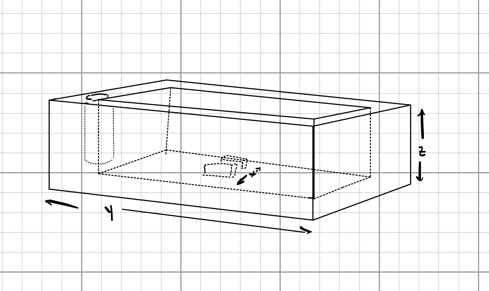
    
To begin the design process, I began by taking measurements of the remote using a mechanical caliper. The general geometry of the part is designed around the y and z measurements, or height and length, while the container will have a snug feature for the x direction, or width. Initially, I consider a component to hold the charger, so measurements were taken for that as well. 
  

    
To improve accuracy of the measurements three measurements of each remote component were taken and the average was used.
  
I modeled three total components for the design. The container including a snug fit for the remote, a matching lid, and the connecting pin which allows it to open and close.
  
At the modeling stage I realized the size of container would increase printing time significantly even without the addition of the cable holster, so I chose to leave the feature out. Additionally, to remove excess filament and create a cleaner part, fillets are used everywhere where the need for dimension accuracy is low. 
  
**CAD Visuals**
  
_Container_  

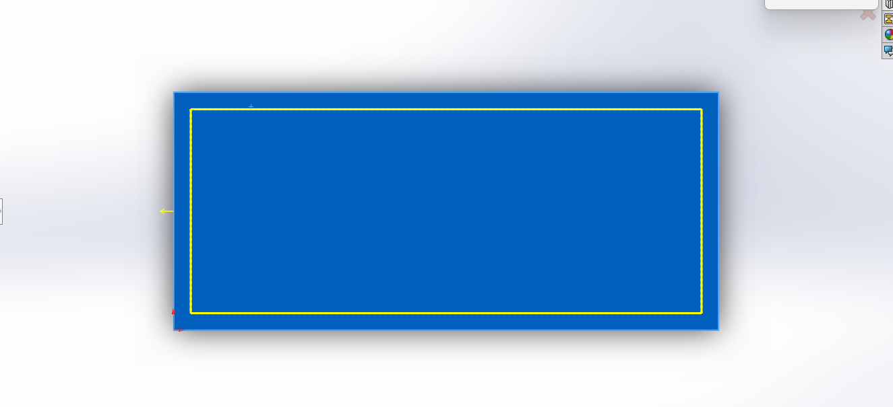
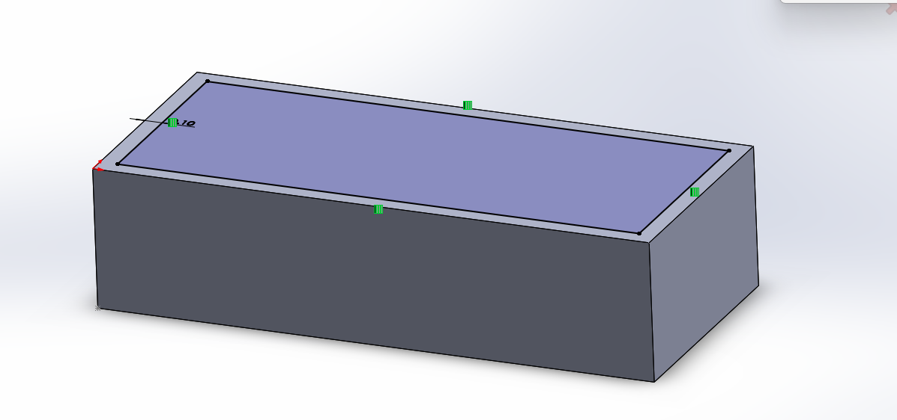
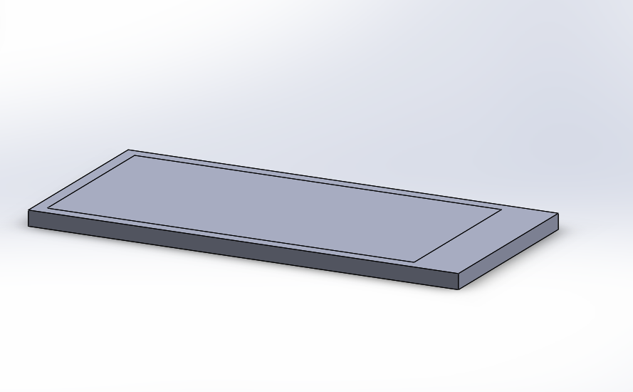

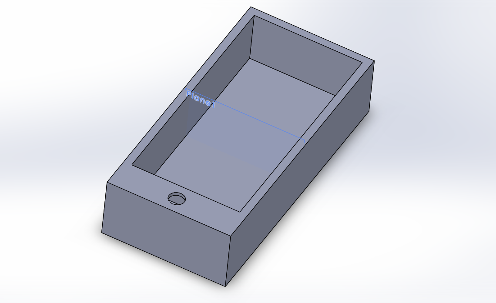
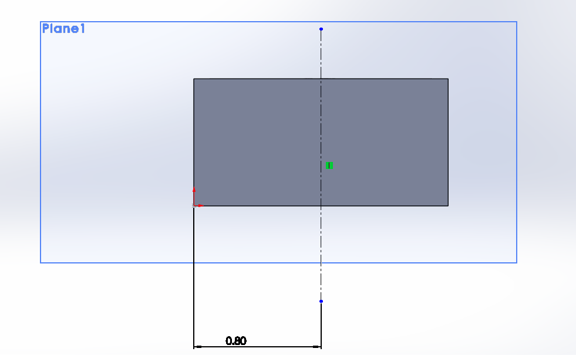
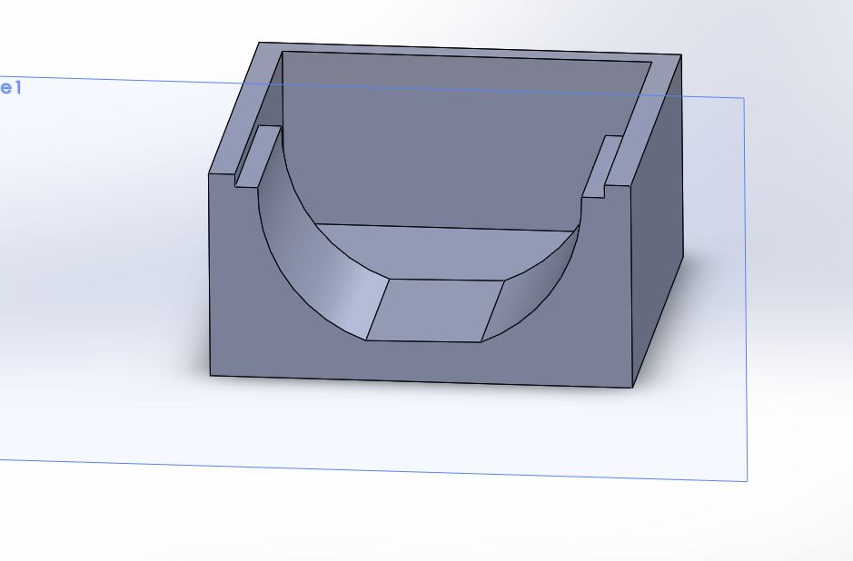
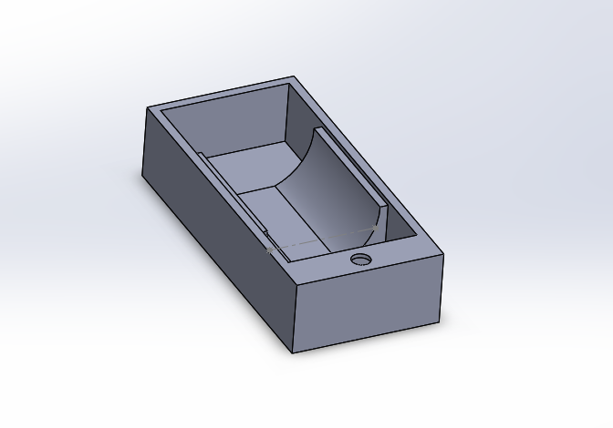

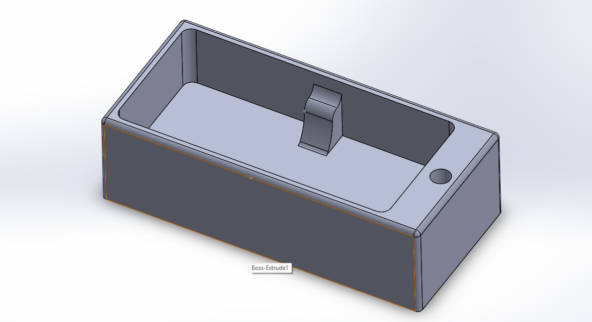

_Lid_  

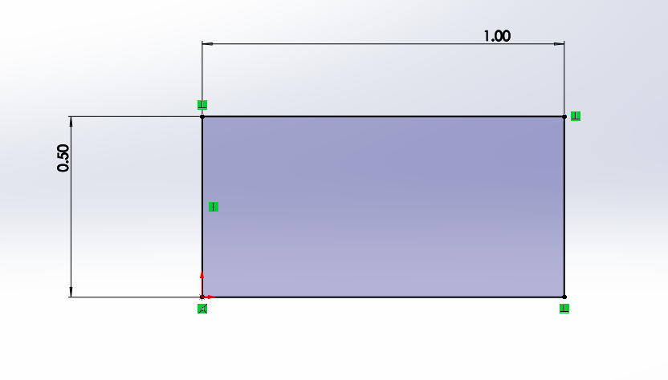
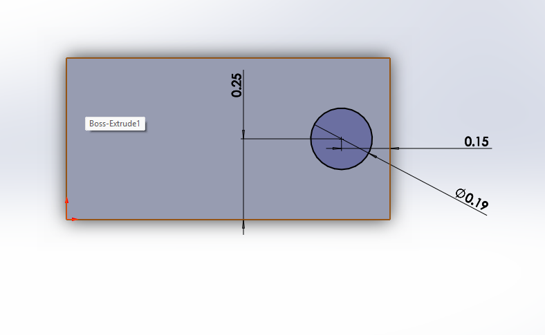
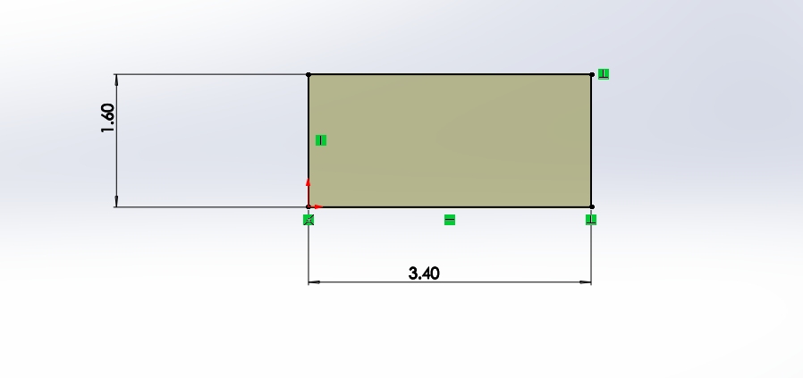
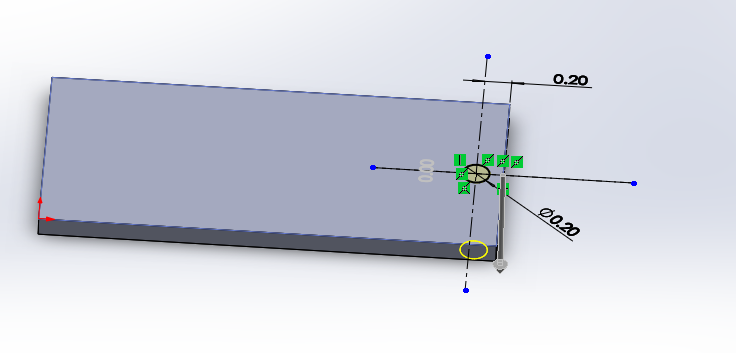

_Pin_  

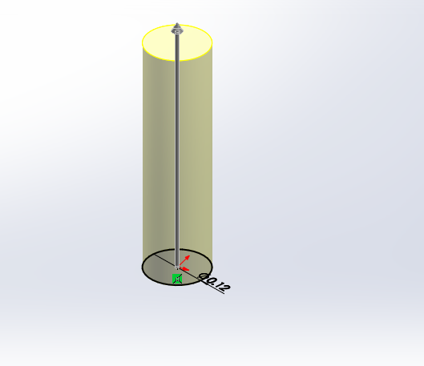

**_Notes on Design Decisions_**  
  
To fit the lid to the pin itself, I used the limitations of the PrusaCore One printing to my advantage. Rather than changing the model dimensions for a particular fit, I left the hole and pin dimensions to align. The intention is that due to the minimum thickness of filament deposited, the hole will be slightly smaller than the measurement used and the pin will be slightly larger. 
  
For the pin hole in the container itself, I chose an RC8 Sliding fit at 0.005 inch. This measurement seemed ideal as it would create a rather wide clearance, accommodating for the pin size difference.
  
To attempt to lower the amount of trials needed to find a correct fit to the remote, I chose to model the snug fit as two features which the distance decreases between as the remote is pushed inside the container. This means the fit gets increasingly more snug as the remote enters the part.
  
**Final Assembly**  
  
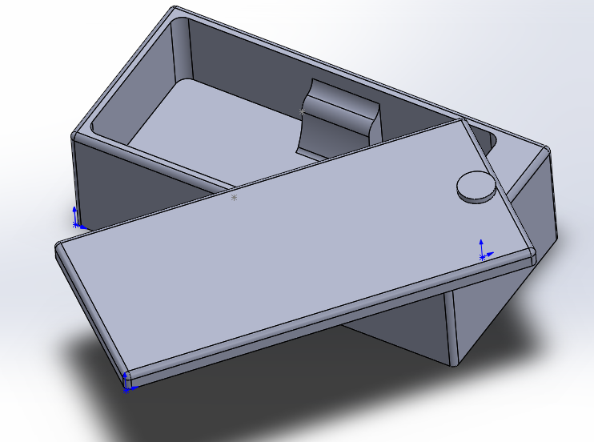
  
## 3D Print
  
For this print, I did not use rafts or supports as they were unnecessary for this design. 
  
In total the parts are 41.29g and have a predicted print time of an hour and thirty-six minutes. This prediction was close to real time as the print took around an hour and forty-five minutes including preheating processes. I chose a Grid infill  and a 15% infill to reduce print time. To continue to increase strength in print, I chose random seam placement for the part as well. Lastly, I set layer height at 0.1mm to increase tolerance accuracy from the default. 
    
I did not want to print the parts separately because of time and machine access limitation, so I oriented all parts on the same plate with only a bit of space between them.

**PrusaSlicer Visuals**
  

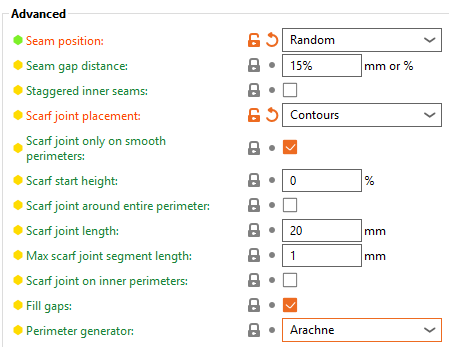

  
**Watch my print:**

## Decide

## Communicate

