# A9 – Laser Cutting

## Objective and Initial Steps
  
- Evaluate laser cutting as a viable manufacturing process. Select and record machine settings, and explain the process's strengths and limits compared with FDM printing.   
- Measure laser kerf and actual material thickness, and apply both as engineered allowances so your joints fit reliably across the whole sheet.  
- Translate a parametric 3D model into 2D cut files, then back into a working 3D assembly.
  
To complete this assignment, I worked with classmate Jack Welch on the design and cutting.

We decided to design a small wooden home model which can be put together similar to puzzle pieces. First, we began splitting the components which we would design and drew rough sketches of our individual components. 

## Analyze  

### Measuring Material and Kerf

Once the general geometry was laid out, the material thickness was measured using an electric caliper. We took measurements of the board three times and then took the average of that data as the final thickness. In this same lab session, we decided to measure the kerf from the Epilogue Laser Cutters and took the liberty to improve the edge quality before the final kit. 

To do this, a 20mm x 20 mm test coupon was drawn in Inkscape with the geometric bounding box setting on to improve the accuracy of part dimensions. The material provided for this project was unclear but FAB lab volunteers recommended we cut at 1/4" default setting rather 1/8" to avoid making a second pass. However, we found this coupon had too much char which uneven edges and recut using 1/8". This improved the edge quality and we measured the kerf from this coupon.

## Decide

### Fit Test, Chosen Clearance, and Parameter Table
Closing out this lab session we made use of the test coupon in a "teeth groove" design to test a chosen clearance based on the kerf. It took two attempts to find the final clearance used in the final kit, for a tight press fit, recorded in the parameter table below.

**Parameter Table**
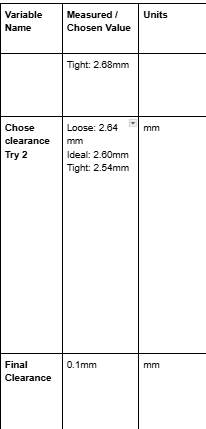
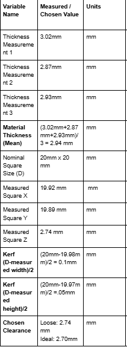

Once clearances were determined and the geometry and intended assembly had been decided, I parametrically modeled my share of the components in Fusion. I chose to use Fusion both to align with my partners CAD system and simplify the process needed to prepare the files to cut.

**CAD VISUALS**  
_Sides_

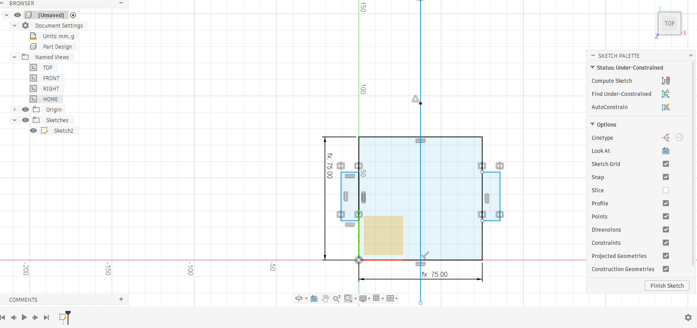

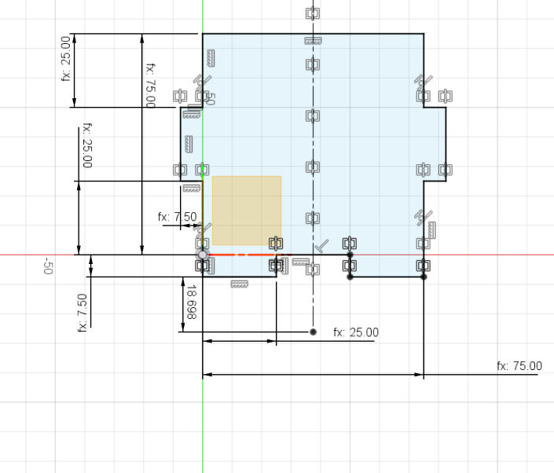

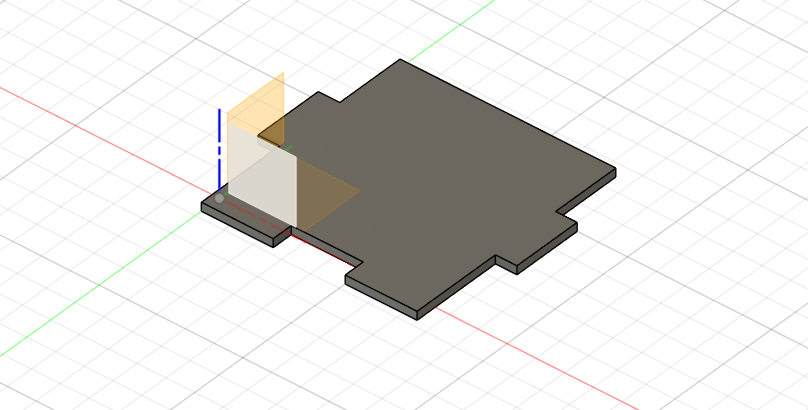

_Floor_  

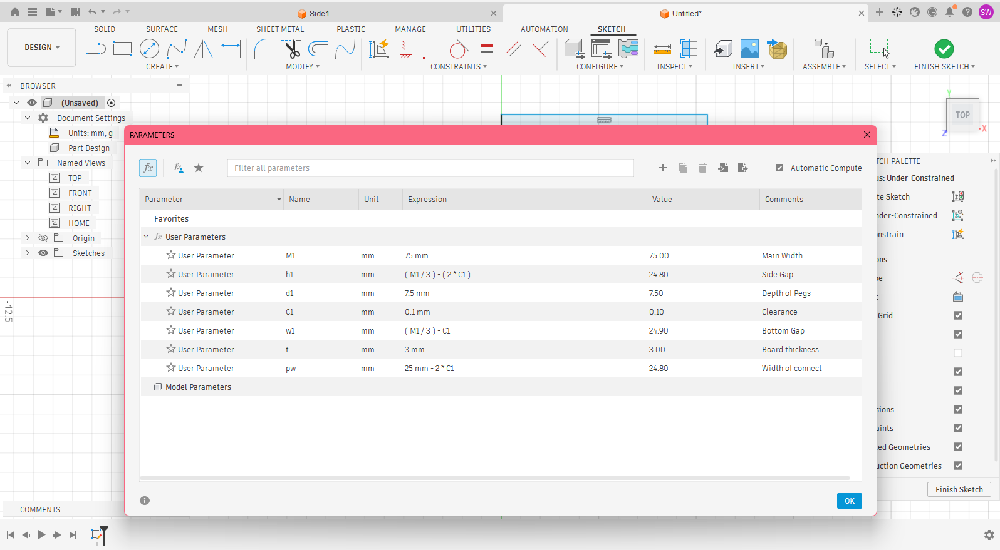  

_Roof_

## Communicate 
### Final Kit Cut Attempts
In the process of cutting the final kit of our design we discovered two major issues. Dimensions had not been communicated well between us throughout the modeling process causing tolerances to be misplaced throughout the design. Additionally, some parts were more singed than preferred and where redone with adjustments were made to clean up the edge quality. Including decreasing the speed and the number of passes to two. 

Below are the failed parts, of those I designed, which were discarded. There were many reasons including but not limited to a too tight tolerance on one side causing fracture in the floor, charring beyond what was achieved previously, etc. 
  
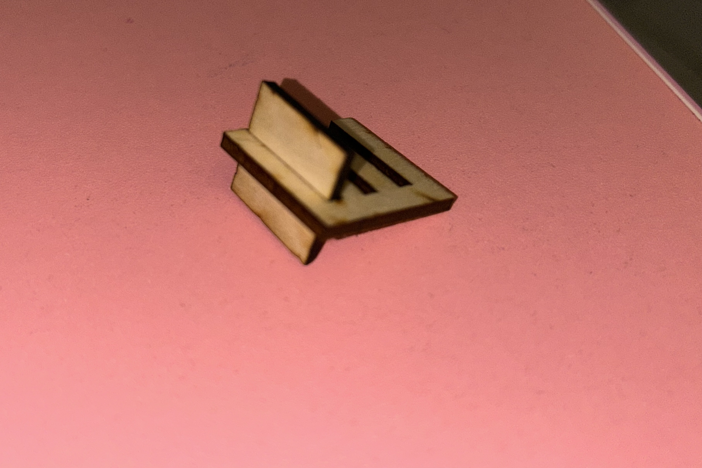
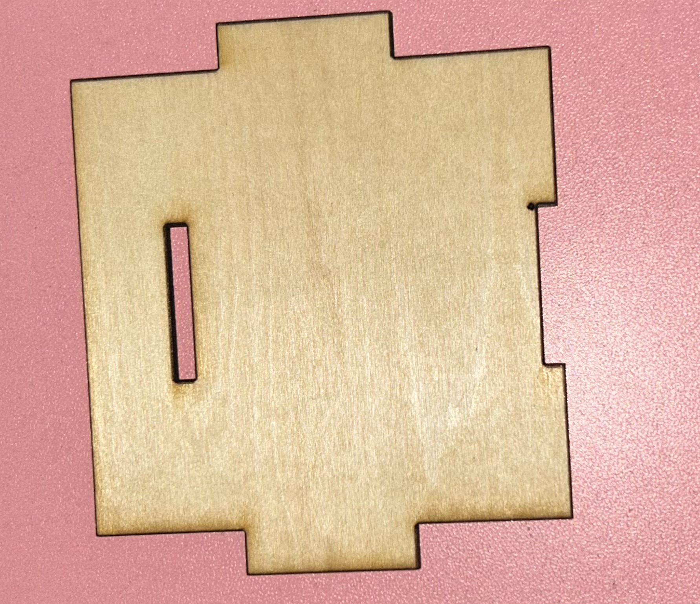
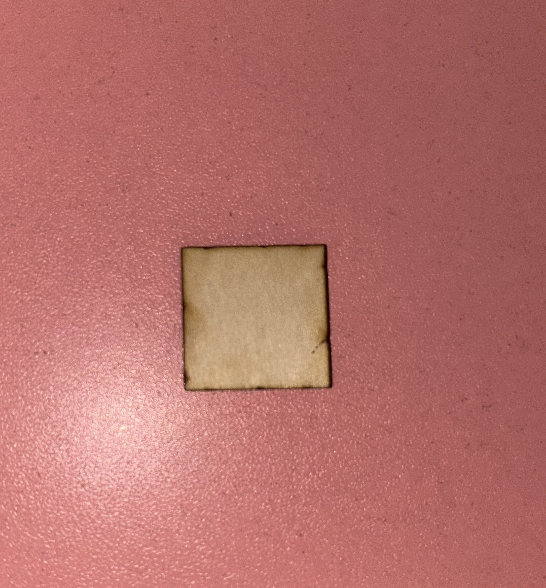
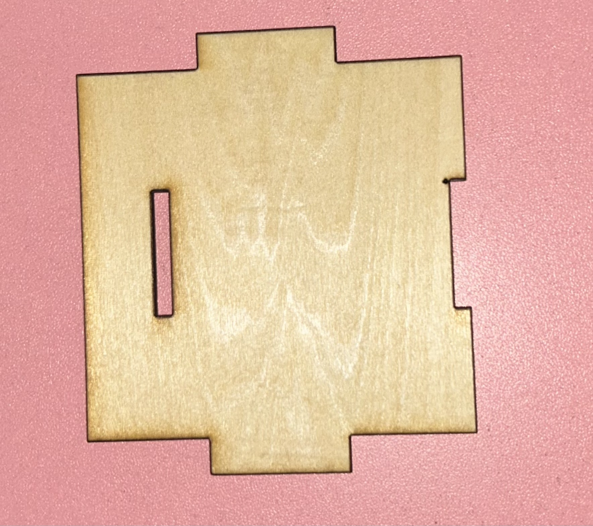
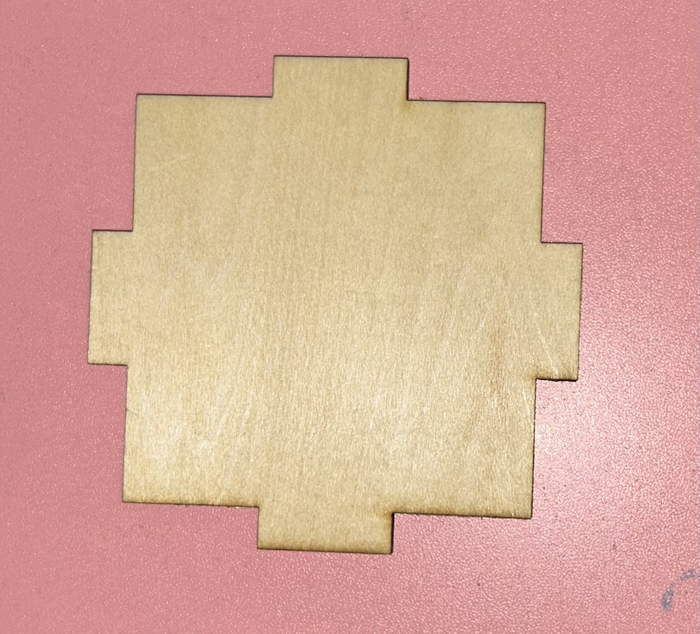
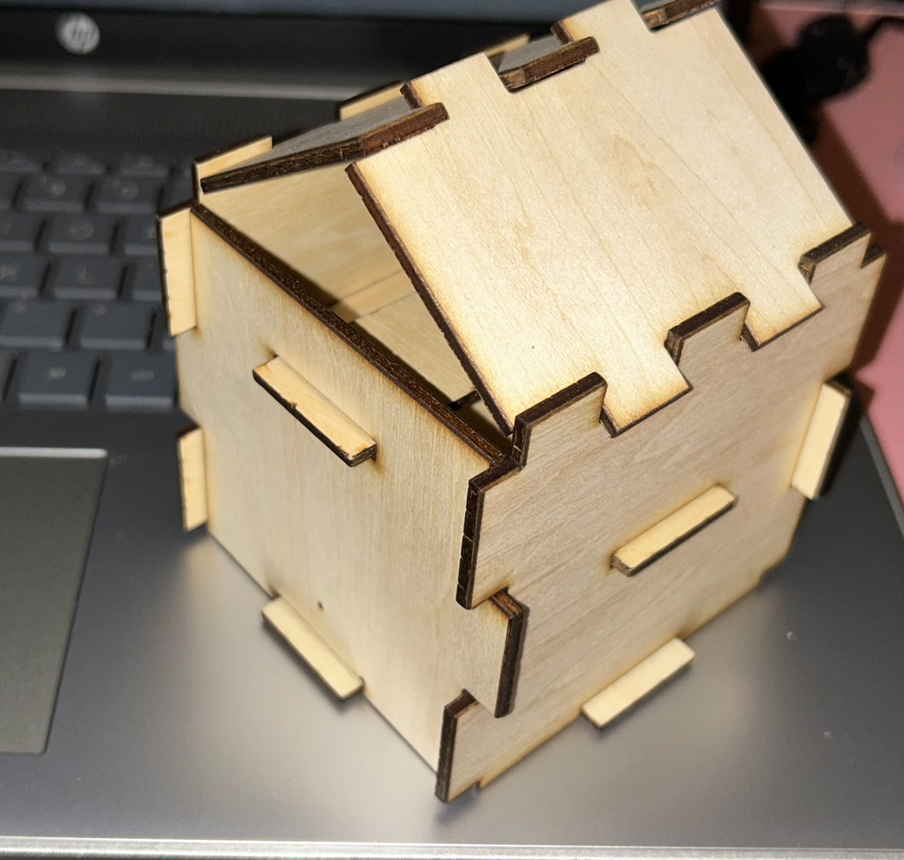
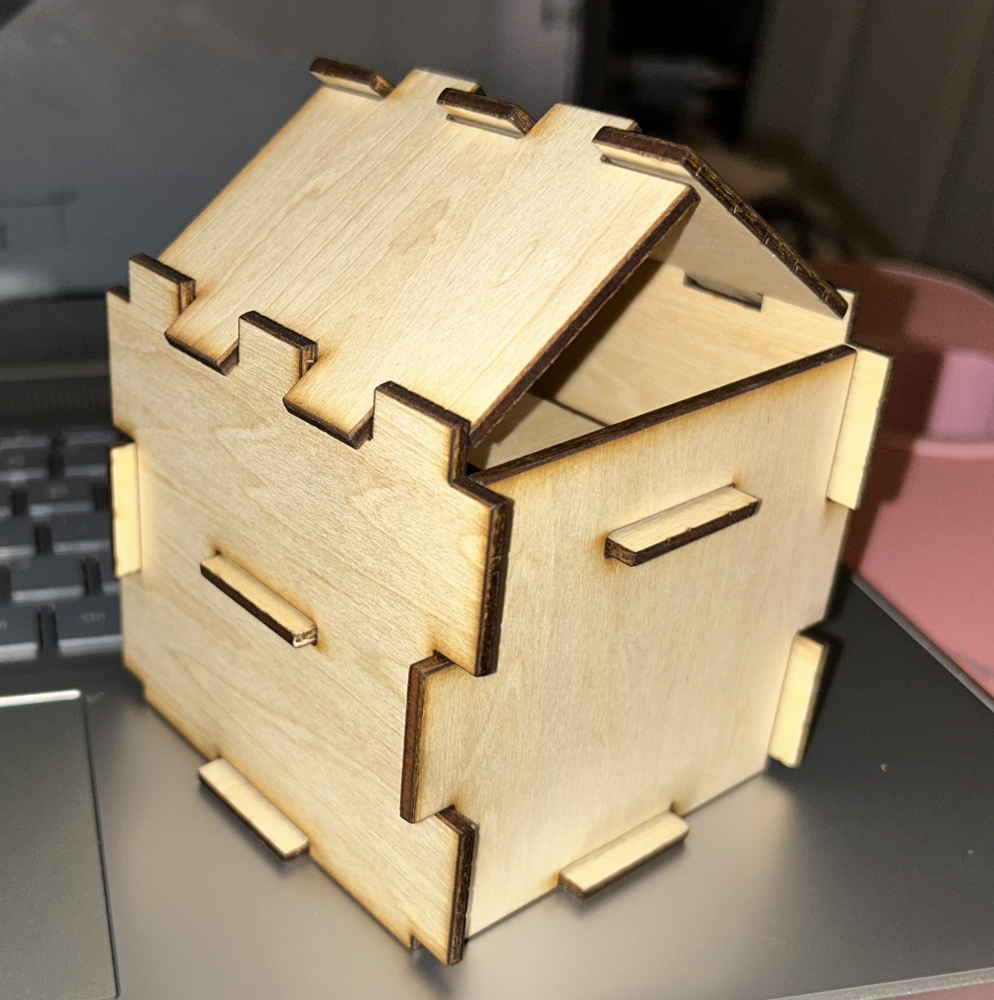
  

Once we communicated, and compared our CAD files side by side, all errors were discovered. Additionally, we decided to another supporting beam through Jack's design of walls to increase the overall stability of the house.

**Watch the Cuts or Download the Files**
https://drive.google.com/drive/folders/1IzoxIToqCER9lnqqXOJK_Xo5DhIN1F68?usp=sharing

**Cut Setting Table**

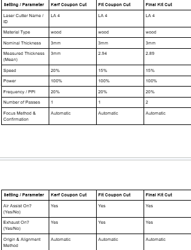

### Successful Final Kit
## Lessons Learned (pictures + paragraphs)

Through this assignment, I learned the requirements to safely and successfully laser cutting thin wood. One of the insights I gained from that experience is the importance of creating a test which aligns with your given design. It was difficult to place our exact clearances at first when comparing the test coupon to our design because of the orientation of the test. Additionally, the many failed parts which contributed to the process of creating the kit taught me the importance of thorough communication. If we had compared our parts closer, or talked things through more before acting, there may have been less failures along the way. Lastly, in the future, I may have considered doing larger slots for the sliding fits of this design. I believe some of the difficulty in finding a clearance was a result of its small magnitude. 

**Process Log**
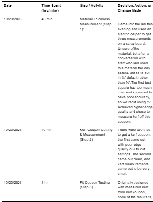
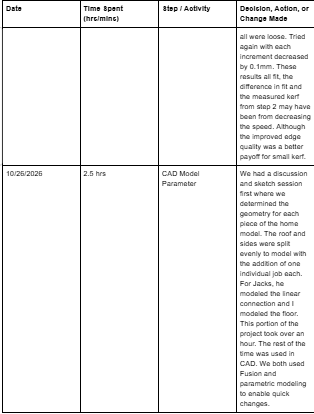
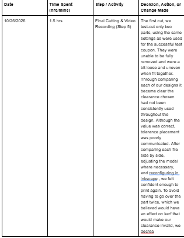
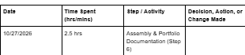

