# A9 – Laser Cutting

## Objective
  
- Evaluate laser cutting as a viable manufacturing process. Select and record machine settings, and explain the process's strengths and limits compared with FDM printing.   
- Measure laser kerf and actual material thickness, and apply both as engineered allowances so your joints fit reliably across the whole sheet.  
- Translate a parametric 3D model into 2D cut files, then back into a working 3D assembly.
  
To complete this assignment, I worked with classmate Jack Welch on the design and cutting.
  
## Design
Jack and I decided to design a small wooden home model which can be put together similar to puzzle pieces. First, we began splitting the components which we would design and drew rough sketches of our individual components. 

Once the general geometry was laid out, the material thickness was measured using an electric caliper. We took measurements of the board three times and then took the average of that data as the final thickness. In this same lab session, we decided to measure the kerf from the Epilogue Laser Cutters and took the liberty to improve the edge quality before the final kit. 

To do this, a 20mm x 20 mm test coupon was drawn in Inkscape with the geometric bounding box setting on to improve the accuracy of part dimensions. The material provided for this project was unclear but FAB lab volunteers recommended we cut at 1/4" default setting rather 1/8" to avoid making a second pass. However, we found this coupon had too much char which uneven edges and recut using 1/8". This improved the edge quality and we measured the kerf from this coupon

Closing out this lab session we made use of the test coupon in a "teeth groove" design to test a chosen clearance based on the kerf. It took two attempts to find the final clearance used in the final kit, for a tight press fit.
**Sides**

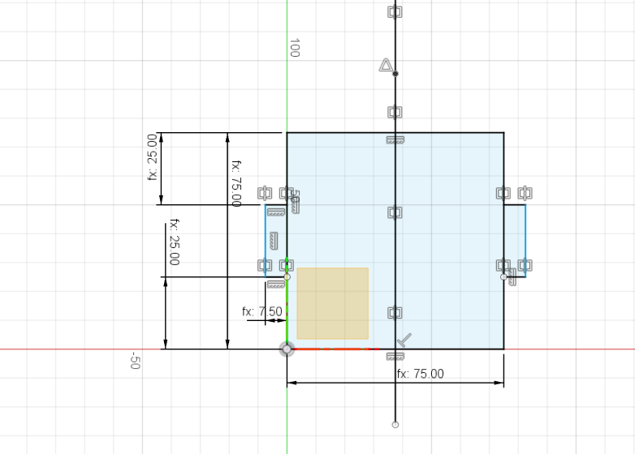
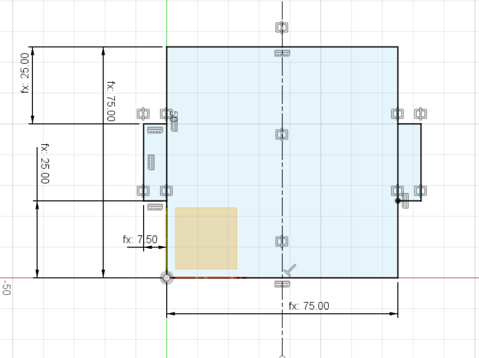
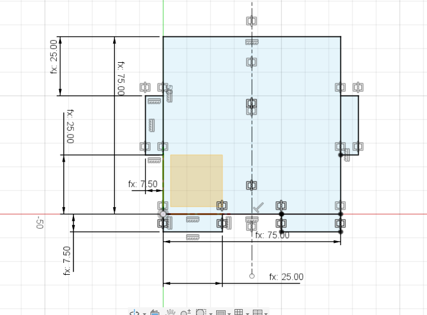

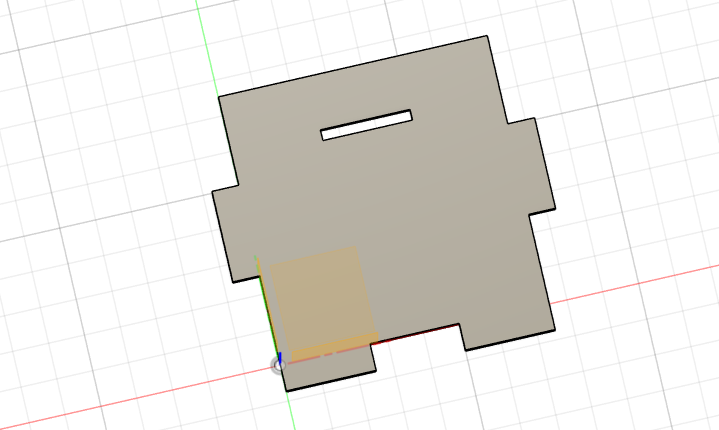
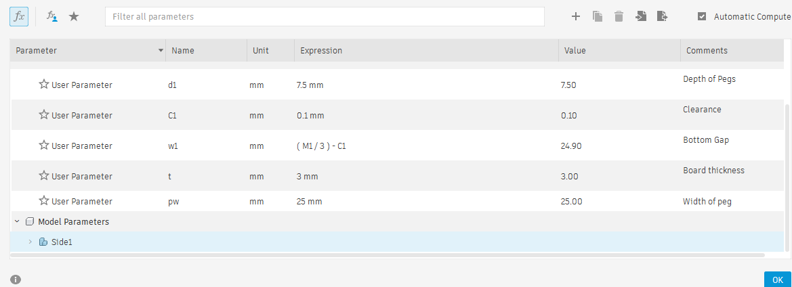
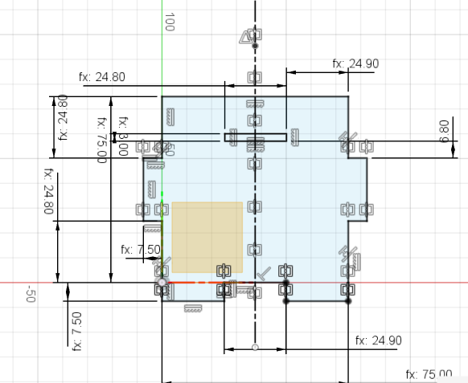

**Floor**
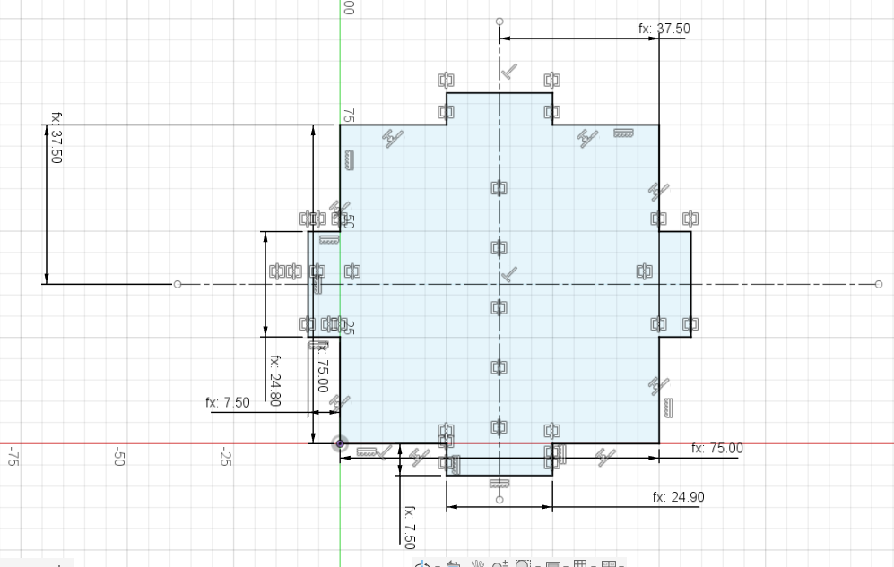
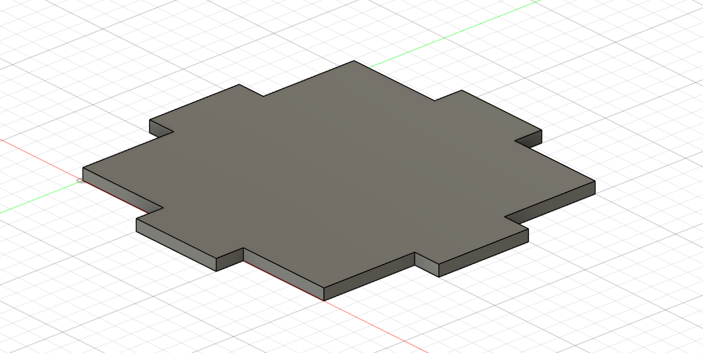

**Roof**
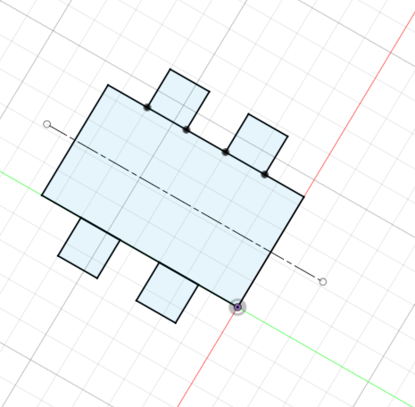
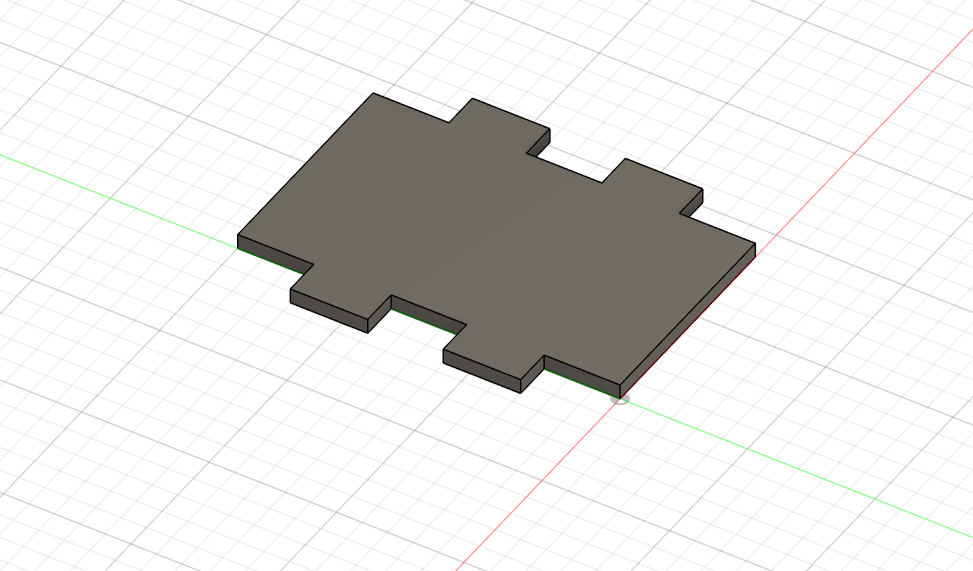

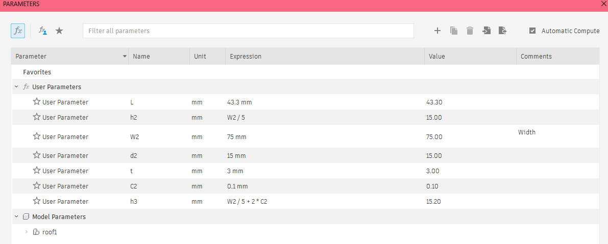
### Measuring Material and Kerf
### Fit Test
## Manufacturing, including Process Research (pictures + paragraphs)
### Final Kit Cut Attempts
### Successful Final Kit
## Lessons Learned (pictures + paragraphs)

