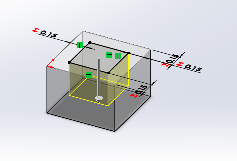
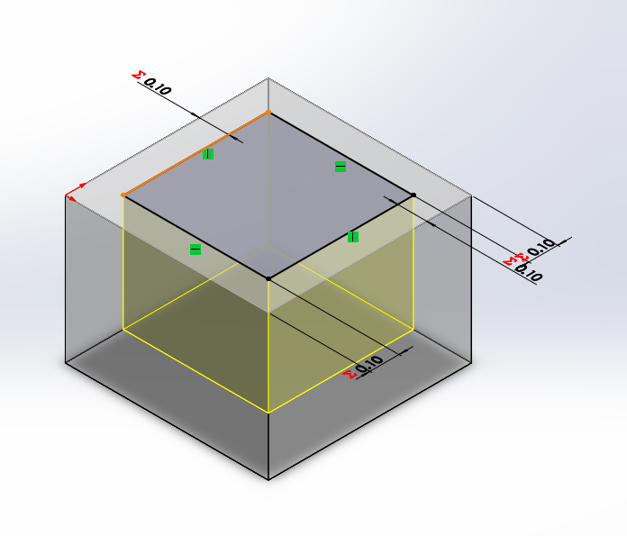
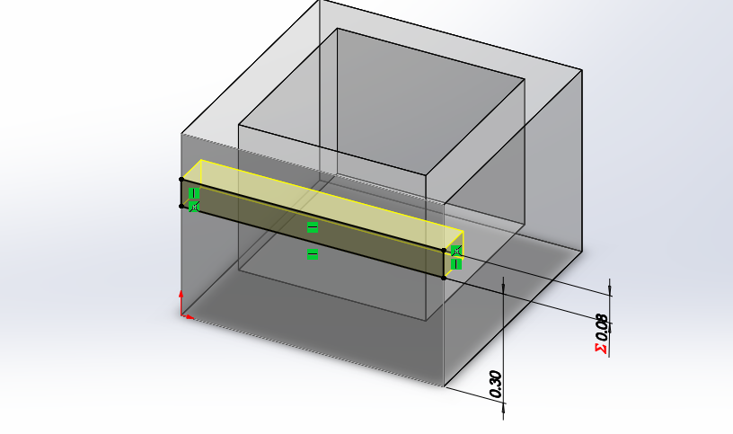
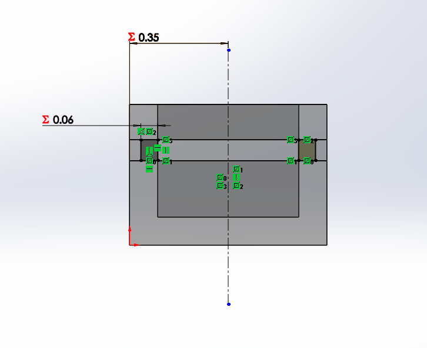
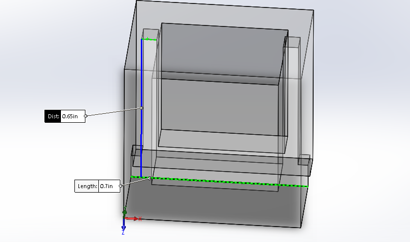
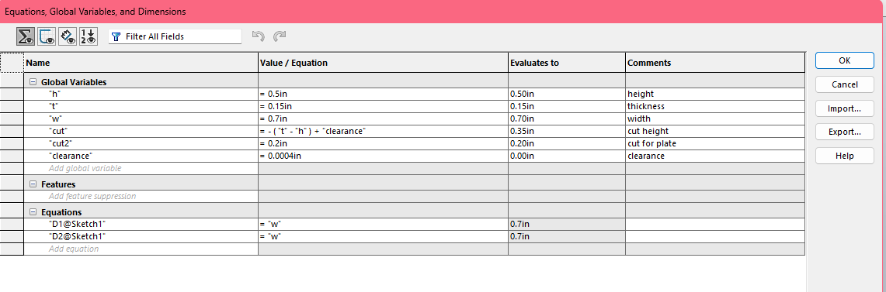
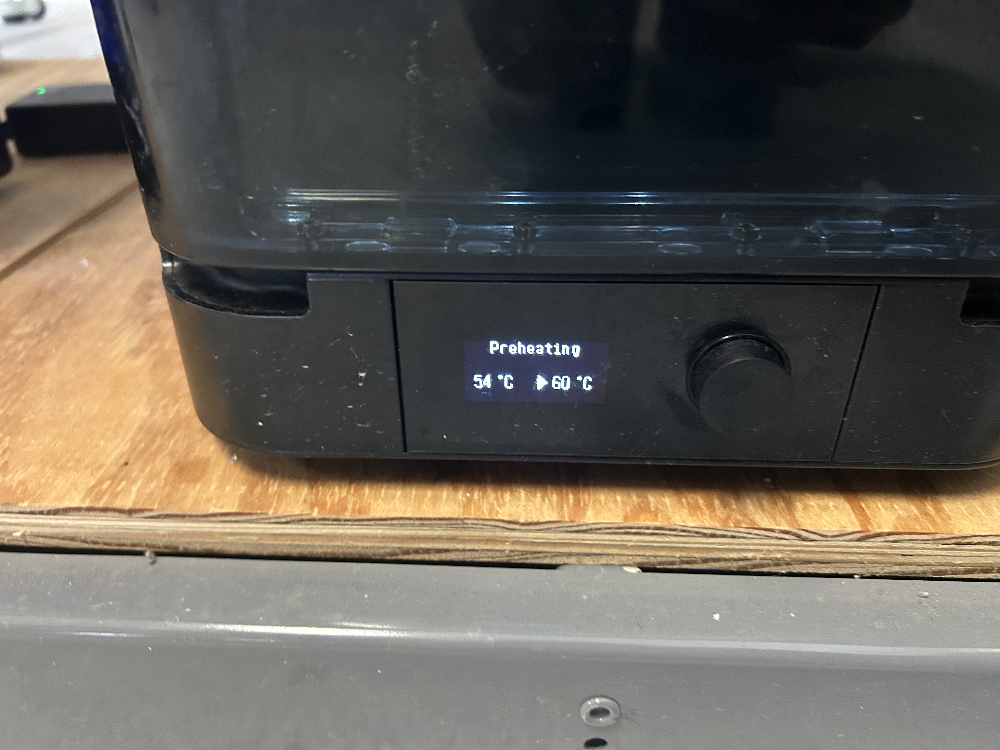
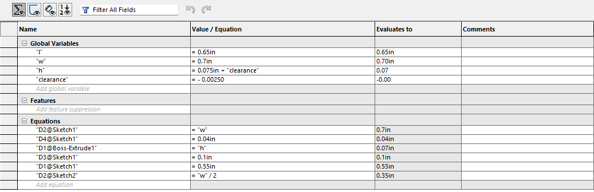
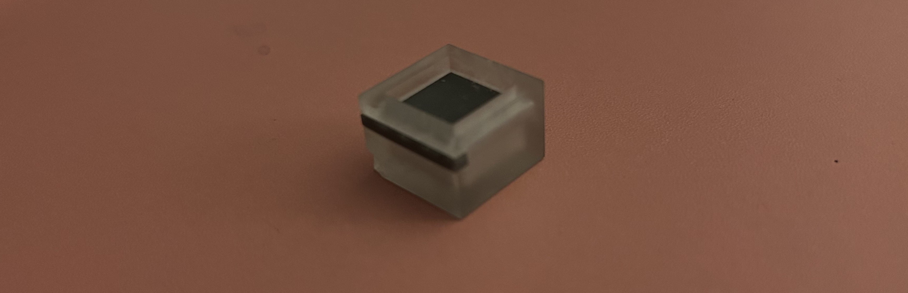

# A10 – RC2 Sliding Fit Design and Verification

## Objectives
- Research the RC 2 fit specification from the Machinery’s Handbook.
  
- Measure your printed features (hole/slot and shaft/feature) using calipers.
  
- Show your printed part set in class to verify the fit and documentation.
  
- Total volume of the two parts may not exceed 20mL including supports.
  
## Research and Planning

For my design, I decided to utilize the RC2 sliding fit to create a prototype of a box with a false floor which hides a compartment. This was inspired by sliding of modern dresser drawers and the way they lay flush to the surface.
### Machinery's Handbook Research
### Real World Applications

RC2 sliding fits may be used for gear or parts which must stay in plate and eb able to be removed, or replaced, easily. This clearance is especially well fit for smooth movement such as that needed for twist on and off containers utilizing threading. I would, and will, avoid use of an RC2 fit when using an assembly which is not intended to be used at high speeds. 

### Shrinkage or Expansion of Parts

To finish the planning for the design, I researched the shrinkage that must be considered when intending to SLA print. I found that the maximum shrinkage, which is often times dependent on the specific resin, has been found at a maximum of 11.2%.

Additionally, to determine the minimums for my design, I found the specifications for the Form 4 SLA printers which we have access too. For this design, the most important specification takeaways include the minimum unsupported wall thickness, the minimum supported wall thickness, and the minimum clearance. On the Form Labs website, the minimum clearance is set at 0.4 mm, dramatically higher than the RC2 sliding fit recommendation found in the Machinery's Handbook. 

Ultimately, this influenced me to choose a clearance in between the two found in research. If anything, I viewed this as a test to the limitations of the machinery. Because of this, I chose to only use a clearance which accounted for the sliding fit alone and use the results to determine what changes would be necessary to the clearance for shrinkage.

### Sketch Visuals

  
## CAD Design
I modeled this part in SolidWorks and checked my dimensions before printing through an assembly of the CAD files which make it up. The model was parametrically modeled using smallest viable dimensions while still demonstrating the function of the design. I chose to prioritize designing a small part, as SLA has more post-processing than FDM printing. This way reprints are cost lost less time overall.

The insert feature of my model is the hidden floor panel and the slot exists as a part of the box.

**CAD Visuals**  
  

**Initial Values**  
  
  

## Preprocessing for 3D Printing
  
**Print Settings**  

For the print itself, I teamed up with two other students to print my first parts using clear standard resin. 
  

  
## Post-Processing 
  
Using the Initial Values mentioned above for false floor design, did not have favorable results. Once supports were removed, I attempted to test my print, not accounting for the need to do the final cure. Although the parts fit, I found it to be too tight, and attempted to remove the plate with pliers. This subsequently shattered the plate in the lab, which I was unfortunately unable to document. Luckily, however, the box was preserved, and I used electric calipers to measure the inside slot fixture post curing. I directly translated these measurements from percent into parametric model changes for the inserting plate. I found this to be around 6% expansion. I was advised by a classmate that clear resin is generally weaker so I chose to do this reprint in grey. With these new dimensions of a clearance at 0.0025in, and material, I found success!
  
**Print 1 Visuals**
   

  
**Final Parts**  

   
## Fit Test

I chose to combine my fit test with my initial print. With the first plate completely fractured, the image below showcases it best. For this test, I used 0.0004in clearance.
  

  
## Lessons Learned

The primary challenge that arose from achieving the RC2 fit is that the machining clearances provided in the Machinery's Handbook do not align with the limits of the Form 4 printer. This assignment taught me it is not smart to try and fight the machinery, but to rather always consider it thoroughly in the design. Additionally, I wish I had documented each of the post-processing sessions, rather than just the first. In the future, I will keep this in mind as I think it would helpful to further understand what contributes to poor surface finishes. The primary reason my first plate shattered was due to the roughness on the surface from poor support placement. To improve accuracy, I could improve support placement based on the function of my design and tolerance placement that goes with that. Lastly, taking and comparing the measurements within the process of SLA printing was difficult as I didn't want to use any calipers in the lab on a sticky product. I assumed the part had expanded because I did not think to take measurements immediately out the bath, as I felt the surface was still tacky. Another improvement to accuracy would be considering that properly, as I would have had a fit that is more accurate to the Machining definition

**Final Chosen Clearance:**  0.0025in
  
**Time Spent:** 7.5 hrs

### Resources
- https://formlabs.com/blog/ultimate-guide-to-stereolithography-sla-3d-printing/
- https://www.3dmag.com/3d-wikipedia/resin-printing-sla-uv-resin-technology-guide/
- Machinery's Handbook

