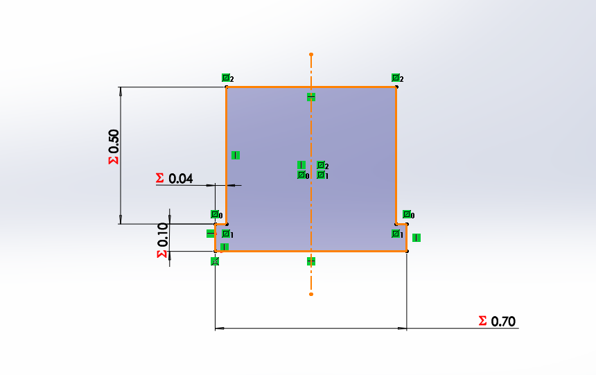
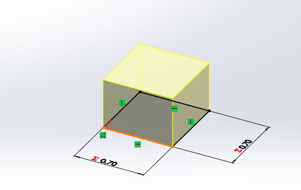
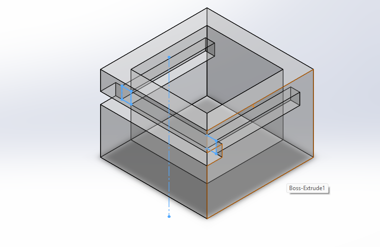
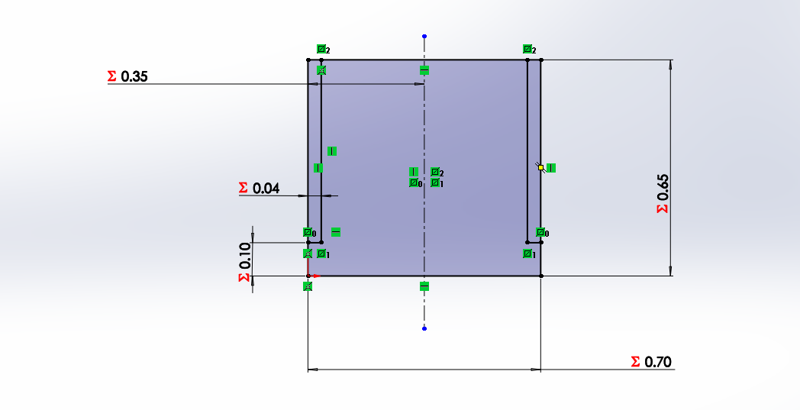
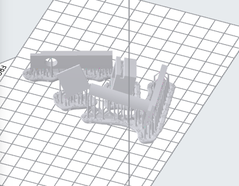
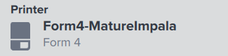
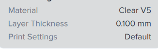
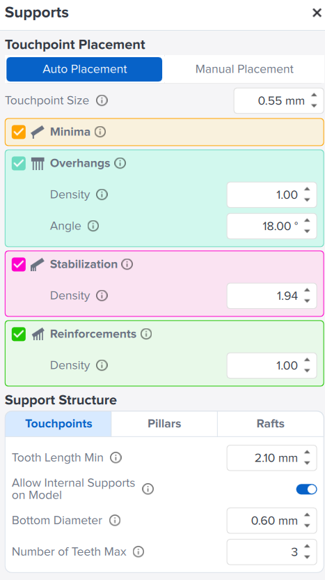
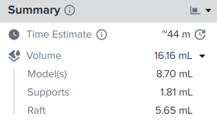
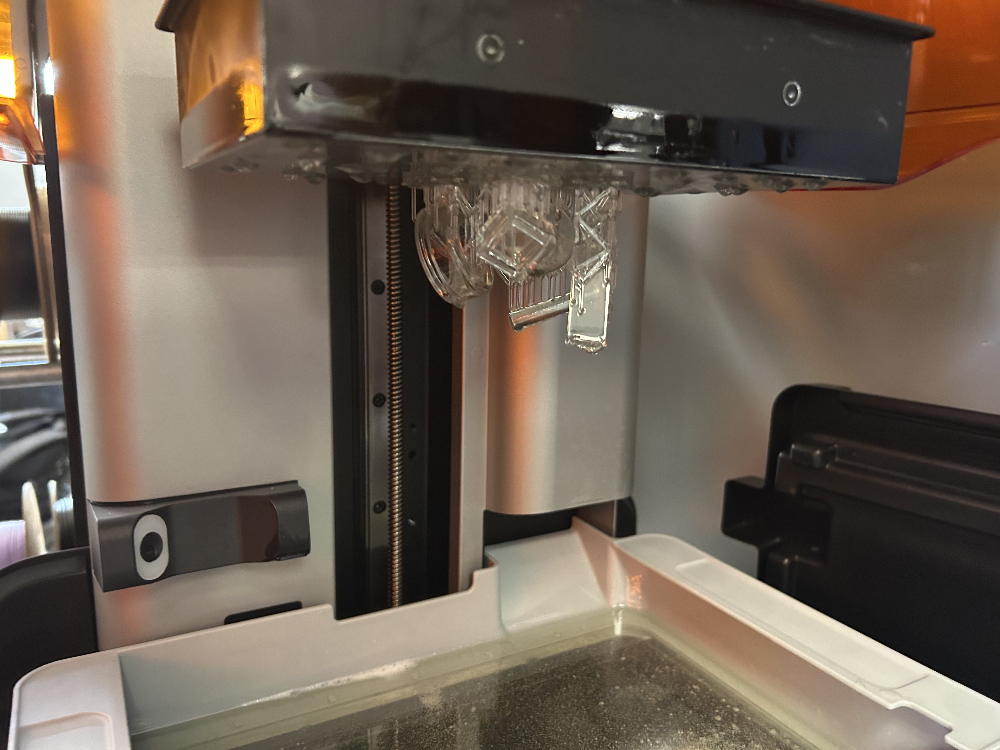

# A10 – RC2 Sliding Fit Design and Verification

## Objectives
- Research the RC 2 fit specification from the Machinery’s Handbook.
  
- Measure your printed features (hole/slot and shaft/feature) using calipers.
  
- Show your printed part set in class to verify the fit and documentation.
  
- Total volume of the two parts may not exceed 20mL including supports.
  
## Research and Planning

For my design, I decided to utilize the RC2 sliding fit to create a prototype of a box with a false floor which hides a compartment. This was inspired by sliding of modern dresser drawers and the way they lay flush to the surface.
### Machinery's Handbook Research
### Real World Applications

RC2 sliding fits may be used for gear or parts which must stay in plate and eb able to be removed, or replaced, easily. This clearance is especially well fit for smooth movement such as that needed for twist on and off containers utilizing threading. I would, and will, avoid use of an RC2 fit when using an assembly which is not intended to be used at high speeds. 

### Shrinkage or Expansion of Parts

To finish the planning for the design, I researched the shrinkage that must be considered when intending to SLA print. I found that the maximum shrinkage, which is often times dependent on the specific resin, has been found at a maximum of 11.2%.

Additionally, to determine the minimums for my design, I found the specifications for the Form 4 SLA printers which we have access too. For this design, the most important specification takeaways include the minimum unsupported wall thickness, the minimum supported wall thickness, and the minimum clearance. On the Form Labs website, the minimum clearance is set at 0.4 mm, dramatically higher than the RC2 sliding fit recommendation found in the Machinery's Handbook. 

Ultimately, this influenced me to choose a clearance in between the two found in research. If anything, I viewed this as a test to the limitations of the machinery.

### Sketch Visuals

### Resources
- https://formlabs.com/blog/ultimate-guide-to-stereolithography-sla-3d-printing/
- https://www.3dmag.com/3d-wikipedia/resin-printing-sla-uv-resin-technology-guide/
- 

## CAD Design

**CAD Visuals**  
  

  
## Preprocessing for 3D Printing
**Print Settings**  
  

## Post-Processing 

**Print 1 Visuals**
  

  
**Final Parts**  
  

## Fit Test

## Lessons Learned

